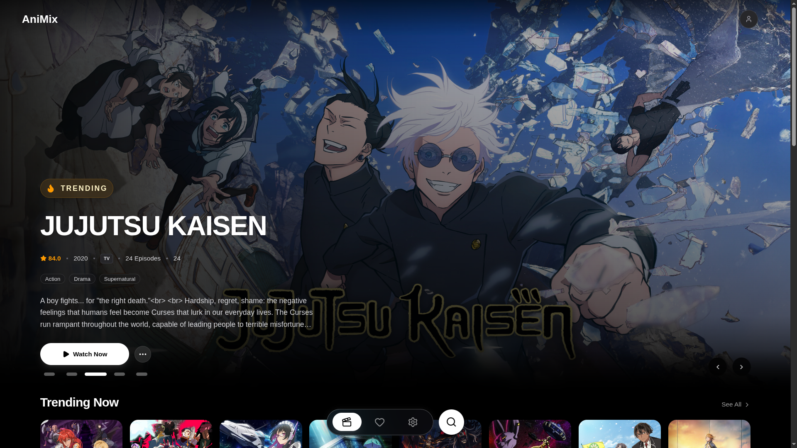
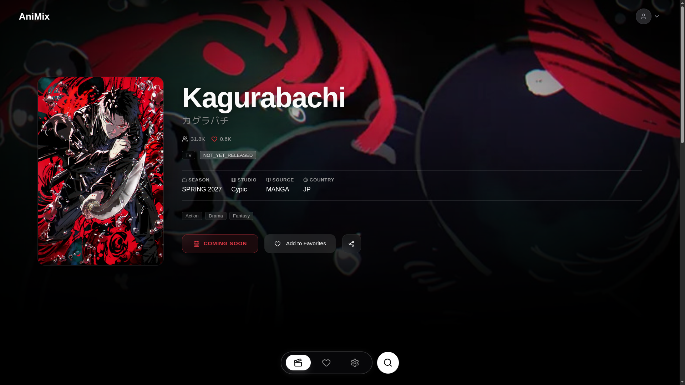
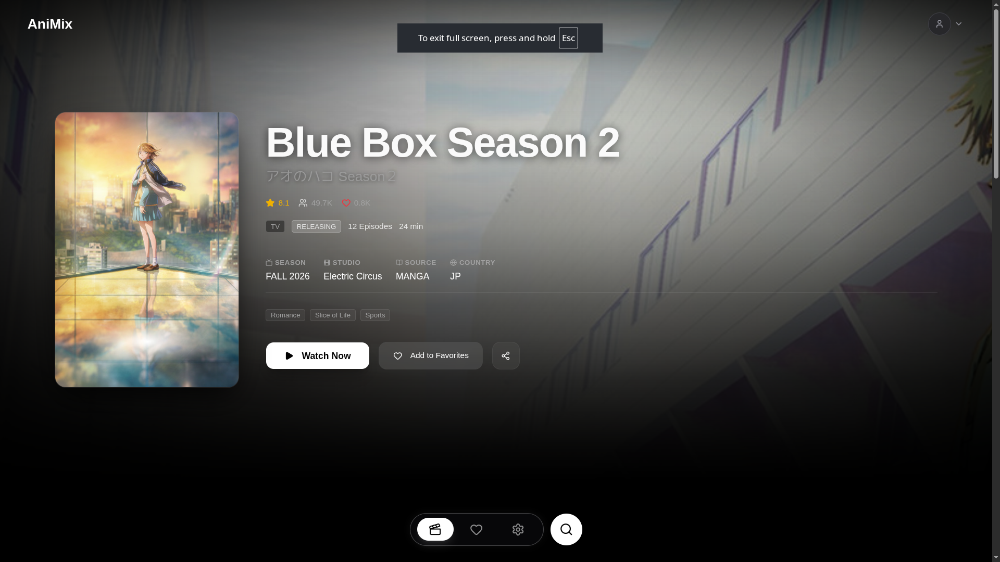
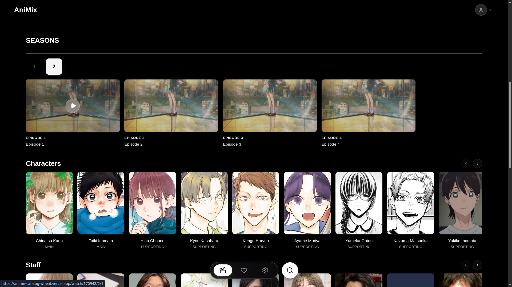
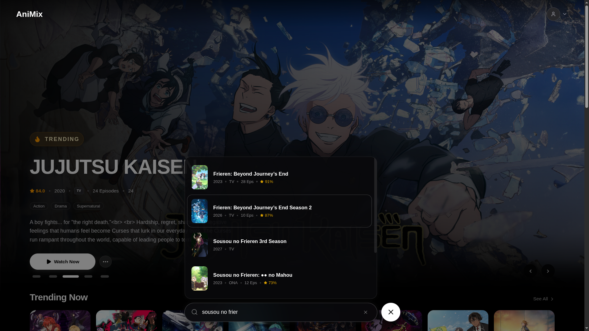
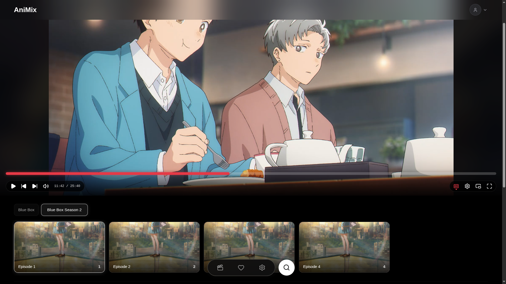

# AniMix — Anime Discovery & Streaming Platform

AniMix is a full-stack anime discovery and streaming platform built with Next.js, React, TypeScript, Express, and PostgreSQL. It allows users to discover anime, explore seasons and episodes, manage their favorite titles, and watch available streams with subtitle support.

**[Live Demo](https://anime-catalog-wheat.vercel.app/)** · **[GitHub Repository](https://github.com/kimtsuny/AniMix)**

## Features

- **Anime Discovery** — Browse anime titles and explore detailed information.
- **Search** — Find anime through the search interface.
- **Season & Episode Navigation** — Browse seasons and select episodes.
- **Video Streaming** — HLS-based playback using HLS.js.
- **Subtitle Support** — Select available subtitle tracks during playback.
- **Authentication** — User registration, login, session restoration, and logout.
- **Favorites** — Save favorite anime using persistent database storage.
- **Responsive UI** — Dark-themed interface designed for different screen sizes.
- **Streaming Provider Integration** — Backend services resolve available streaming sources and support fallback handling.

## Screenshots

### Home Page



### Anime Details



### Anime Details — Alternative View



### Anime Details — Additional View



### Search



### Watch Page



### Watch Page — Episode Playback


## Tech Stack

### Frontend

- Next.js App Router
- React
- TypeScript
- Tailwind CSS
- Framer Motion
- HLS.js
- GraphQL client integration

### Backend

- Node.js
- Express
- TypeScript
- PostgreSQL
- Prisma ORM
- JSON Web Tokens (JWT)
- HTTP-only authentication cookies
- External anime metadata and streaming providers

## Architecture

AniMix separates the frontend, API, database, and streaming-provider integration into distinct layers.

1. **Frontend:** Renders application pages, manages user interactions, handles season and episode selection, and controls video playback.
2. **Backend API:** Exposes endpoints for authentication, anime data, episodes, favorites, and stream resolution.
3. **Database:** PostgreSQL stores users, anime records, seasons, episodes, favorites, and provider mappings through Prisma.
4. **Streaming Services:** Resolve available video sources and normalize stream information for the frontend player.
5. **Video Playback:** HLS.js loads supported HLS streams and works with the available subtitle tracks.

The frontend communicates with the backend through API requests. The backend handles database operations and coordinates with external providers when resolving anime episodes and streaming sources.

## Project Structure

```text
AniMix/
├── frontend/
│   ├── app/                  # Application routes and layouts
│   ├── features/             # Feature-specific modules
│   │   ├── anime/
│   │   ├── auth/
│   │   ├── search/
│   │   └── watch/
│   ├── shared/               # Shared UI components
│   └── package.json
│
├── backend/
│   ├── src/
│   │   ├── config/           # Environment and database setup
│   │   ├── controllers/      # API request handlers
│   │   ├── middleware/       # Authentication middleware
│   │   ├── routes/           # API route definitions
│   │   └── services/         # Business logic and providers
│   ├── prisma/
│   │   └── schema.prisma     # Database schema
│   └── package.json
│
├── docs/
│   └── screenshots/
│       ├── home.png
│       ├── details.png
│       ├── details2.png
│       ├── details3.png
│       ├── search.png
│       ├── watch1.png
│       └── watch2.png
│
└── README.md
```

## Getting Started

### Prerequisites

- Node.js compatible with the project dependencies
- pnpm
- PostgreSQL
- Required environment variables

### 1. Clone the Repository

```bash
git clone https://github.com/kimtsuny/AniMix.git
cd AniMix
```

### 2. Configure the Backend

```bash
cd backend
pnpm install
pnpm dev
```

Configure the required environment variables before starting the server.

### 3. Configure the Frontend

Open a separate terminal from the project root:

```bash
cd frontend
pnpm install
pnpm dev
```

The frontend runs on the default Next.js development port. The backend URL is configured through the frontend's Next.js configuration.

### 4. Database Setup

Configure PostgreSQL and the required database connection string before using database-backed features.

Apply the Prisma migrations using the repository's established migration workflow. Ensure the Prisma Client is generated before running the backend.

## Environment Variables

The backend requires the following variables:

| Variable | Description |
|---|---|
| `DATABASE_URL` | PostgreSQL connection string |
| `JWT_SECRET` | Secret used to sign and verify authentication tokens |
| `PORT` | Backend port; defaults to `5000` |

Configure any additional variables required by the frontend or external services in your local environment.

**Security:** Never commit real credentials, database connection strings, JWT secrets, or session tokens to the repository.

## Development & Quality

Before submitting changes, verify the affected functionality and run the available checks.

- Frontend linting: `pnpm lint`
- Frontend production build: `pnpm build`
- Backend type checking: `pnpm typecheck`
- Backend build: `pnpm build`

Run each command from its respective `frontend/` or `backend/` directory.

## Known Limitations

Streaming availability and playback quality depend on external providers and their infrastructure. Provider availability, subtitle coverage, and playback behavior may vary between titles.

Document any additional known issues here as they are identified and verified.

## Author

**Mohammed**

- GitHub: [@kimtsuny](https://github.com/kimtsuny)

---

*AniMix is a portfolio project built to explore full-stack web development, API integration, database design, authentication, and video streaming workflows.*